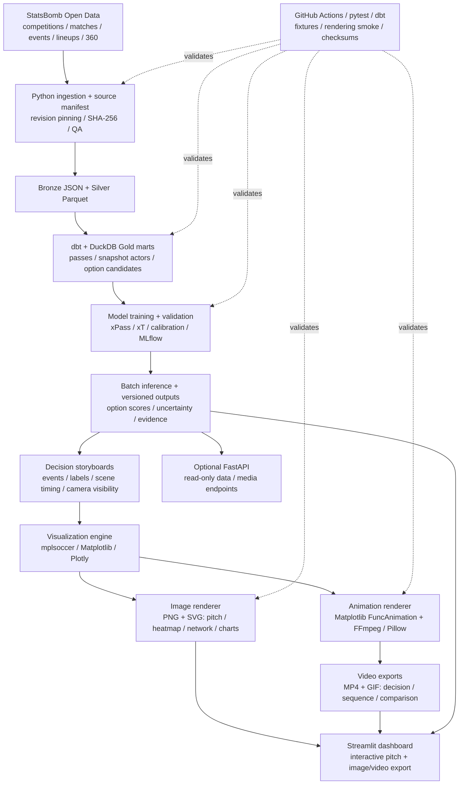

# PassIQ — The Pass That Never Happened
## Reproducible Football Decision Intelligence: implementation + visual storytelling roadmap (v2)

**Updated 23 November 2026:** Static football visuals, animated tactical explainers, and downloadable MP4/GIF clips are now first-class project deliverables with explicit tests and release gates.

**Project goal:** Given a historical football passing event with a StatsBomb 360 snapshot, enumerate visible teammate options, estimate the completion probability and positional attacking reward for each potential pass, and explain how the actual pass compares to modeled alternatives. Make each finding understandable through interactive, publication-quality pitch graphics and reproducible tactical animations, with downloadable PNG/SVG/MP4/GIF assets. Provide transparent uncertainty and data-coverage information; do not claim to know counterfactual match outcomes.

**Recommended scope:** 2022 Men's World Cup as the initial dataset (StatsBomb competition 43, season 106); one match and one video storyboard as a vertical slice before full-tournament processing. **Timeline:** 8 weeks at ~12–16 focused hours/week, contingent on data coverage, model results, and rendering complexity. **Budget:** local development first; avoid paid APIs, paid video services and licensed broadcast footage. **Delivery rule:** Data correctness and uncertainty are required; visual polish must never obscure model limitations.

### Project acceptance definition
- A fresh clone can reconstruct the analytic dataset from a documented, pinned upstream revision and build models and dashboard using documented commands.
- Each pass and each visible alternative is traceable to a source match ID/event UUID and an identifiable run/configuration version.
- Predictions and rankings have documented validation and uncertainty; counterfactual options are labeled model estimates, not factual missed opportunities.
- No leakage from future events into inference-time features; match-level splits, pre-event scores, and training-only fitting.
- Streamlit demo supports a match event replay, alternatives, player/team aggregation and model/data caveats.
- At least four **real-data-derived, publication-quality** visual outputs are reproducible: 360 decision pitch; xT heatmap; actual-pass network; model calibration/uncertainty figure.
- A **Generate Tactical Clip** workflow reproducibly exports one **10–20 s** annotated passing-decision video (MP4) and GIF preview, with a user-selectable event and a clear label stating **"data-driven reconstruction, not match footage"**.
- Additional clip templates create an observed-event sequence explainer and a team/player comparison, each with a minimum one verified fixture. Alternative passes are depicted as *estimated hypothetical options*, never footage of an event that happened.
- Every media asset records match/event IDs, model version, source-data revision, renderer version and export settings in a `render_manifest.json`; snapshot actors remain anonymous when their identity is not grounded.
- **Visual integrity:** freeze-frame positions are observed once per event, not complete player tracking. Never interpolate player movements across snapshots as if their real trajectories were known; use cuts, overlays and explicitly labeled schematic transitions. No third-party match video or unlicensed broadcast clips.

### Visual and video release plan

| Milestone | Images | Video | Evidence of completion |
|---|---|---|---|
| Phase 0 | Wireframes, visual design guide | 3 annotated storyboards | One real scene audited |
| Phase 1 | Raw-data sanity pitch | — | Snapshot coordinates verified |
| Phase 2 | 360 pitch, observed network, draft zone map | — | Reproducible image fixtures |
| Phase 3 | Calibrated performance PNG/SVG, validated xT heatmap | — | Chart metrics match data |
| Phase 4 | Annotated chosen-vs-alternative pitch PNG/SVG | Decision clip storyboard | Provenance + ranking caveats |
| Phase 5 | Exportable figures and interactive dashboard | Clip export UI prepared | PNG/SVG downloadable |
| Phase 6 | Video title/end cards and consistent overlays | **Decision MP4+GIF; sequence and comparison templates** | All three templates tested on real events |
| Phase 7 | CI image artifacts and deployed previews | Cached, playable/downloadable demo clips | Rendering smoke tests + green CI |
| Phase 8 | Research and social share graphics | 60–90 s product walkthrough | Reproducible public portfolio |

---

## Architecture




**Architectural rule:** Use batch scoring and a read-only analytical dashboard for the first version. Render stable showcase images/video ahead of deployment; on-demand exports may be queued or cached by a deterministic **event + model + template + render-config** key. Do **not** train models during a download request. Only add FastAPI when there is a demonstrated separate-client/API requirement. Do not build a live match ingestion system: the data is historical. Keep dependencies locally reproducible.

**Rendering choices:** `mplsoccer` for real-data pitch plots, Matplotlib for export-quality images and animation, Plotly for browser interactivity, Pillow for GIFs, and locally installed FFmpeg for MP4/H.264 (check licensing and runtime compatibility on the deployment target). Streamlit `st.download_button` delivers generated images and clips. Design one canonical visual scene specification consumed by both image and video renderers so the exports agree with the dashboard.

**Visual storytelling rule:** Every media frame must distinguish **observed** (actual on-ball event and visible snapshot), **modeled** (probability / xT / ranked option) and **illustrative** (animations, timed highlights and schematic movement). The UI and video watermark/caption must make this distinction immediately clear.

## Core data contracts

| Entity | Grain / key | Essential fields / notes |
|---|---|---|
| `dim_match` | one row per `match_id` | teams, competition, kickoff, source revision |
| `dim_player` | one row per known `player_id` | names from event/lineup data, not from anonymous 360 actors |
| `fct_event` | one row per (`match_id`, `event_id`) | event time/period/order, team, actor, type, raw coordinate |
| `fct_pass` | one row per pass event | pass end, recipient if recorded, success outcome, pre-event score, match context |
| `fct_360_frame` | one row per joined 360 `event_uuid` | visible-area polygon, player-count, coverage flags |
| `fct_360_actor` | one row per (`match_id`, `event_id`, `frame_actor_index`) | location, teammate/opponent/actor/keeper flags; **no player ID** |
| `fct_candidate_pass` | one row per (`match_id`, `event_id`, `candidate_index`) | every visible teammate option, geometric features, selected-pass association if confidently resolvable |
| `fct_candidate_score` | one row per candidate x model-version | calibrated probability, xT delta, utility estimate, confidence/sensitivity flags |
| `agg_player_decisions` | player x competition x game state | option coverage, selected-pass metrics, uncertainty and sample denominator |
| `fct_observed_pass_link` | one row per observed origin→recipient pass, when recipient is reliably known | team/player links for aggregate **passing networks** (not anonymous frame actor identity) |
| `dim_visual_scene` | one row per (`match_id`, `event_id`, `scene_version`) | pitch coordinates, observed actor indices, actual-pass path, candidate arrows, overlay labels and timestamp metadata |
| `fct_media_export` | one row per (`event_id`, `template`, `model_version`, `render_hash`) | path, output format, render settings, checksum, attribution, generation status and scene provenance |

**Important relationship:** `events.id` → `three-sixty.event_uuid`; `frame_actor_index` is an anonymous positional point, not a named player. A nominal actual-receiver match is an uncertain geometric association between event pass end location and snapshot positions and should carry a match-confidence field. Preserve unmatched and ambiguous cases.

**Coordinate and time contract:** Validate the StatsBomb 120×80 coordinate system; align attack direction when computing positional value; preserve raw coordinates for visual replay. Pitch renderers must render both horizontal and vertical orientations reproducibly and test mirroring of attack direction. Build pre-event game state from goal events in chronological order (including own goals); distinguish regulation, extra time, and penalty-shootout events. Check reversed/edge-period sequences.

**Media contract:** Each saved image or clip is paired with a machine-readable sidecar (or export-manifest entry) containing `match_id`, `event_id`, source commit/checksum, model version, scene template and version, renderer commit, resolution, frame rate, duration, UTC render time, and output SHA-256. Where a clip combines different events, list **every** source event ID. Public assets include source attribution and a clear "synthetic tactical visualization / not broadcast footage" note.

---

## Phase 0 — Problem specification and feasibility (2–3 days)

**Tasks**
1. Create `docs/research_questions.md` defining primary questions: selected versus modeled alternative threat, game-state changes in risk, and role/team patterns. Explicitly separate observed actions from predictions.
2. Define success criteria, baseline models, match-level split policy, dashboard wireframes, and **three visual storyboards** (single pass, observed event sequence, player/team comparison). Select one real-data match/event for the first animation proof of concept.
3. Inspect `competitions.json`, `matches/43/106.json`, event JSON and 360 JSON for three different matches. Quantify event/frame coverage and missingness.
4. Read StatsBomb Open Data attribution and license terms; plan source attribution. Pin an upstream Git commit hash in a `data_manifest.json`.
5. Freeze scope: first version has xPass + xT and risk-reward frontier plus one reusable PNG/SVG pitch renderer and one short annotated tactical MP4/GIF. Defensive-transition counterfactual modeling is optional research extension.
6. Document the graphics style guide: pitch aspect ratio, typography, colorblind-safe pass/defender colors, observed-vs-modeled line styles, mobile-friendly text size, StatsBomb credit and per-scene attribution.

**Deliverables:** research questions, data policy, schema profile, scoped MVP, 3-match feasibility notebook, dashboard wireframes, clip storyboard sketches and visual style guide. **Exit gate:** event-to-frame joins verified; at least 20 real candidate-option pitch plots; one sample freeze-frame scene with verifiable provenance and readable overlays.

## Phase 1 — Ingestion and raw/normalized data layers (Week 1)

**Tasks**
1. Implement a downloader that reads a pinned match manifest and retrieves only required raw files. Verify SHA-256 and source revision. Make reruns idempotent.
2. Store immutable JSON in `data/raw/` (gitignored). Maintain `data_manifest.json` with per-file match ID, source revision, checksum, and fetch date.
3. Normalize match metadata, events, passes, 360 frames, and anonymous actors to Parquet. Keep nested raw payload where needed to diagnose parser decisions.
4. Create ingestion QA counts: number of matches, events, passes, 360 frames, joined passes, candidates per frame, malformed/missing snapshots.
5. Decide exclusions: set pieces, incomplete locations, frames with no viable candidates, and mismatched phases; log reasons rather than silently dropping.
6. Save visual QA fixtures including a typical pass, touchline pass, edge-of-pitch pass, ambiguous intended recipient, sparse frame and period-direction switch. Keep these as small compliant fixtures for tests rather than redistributing whole match datasets.

**Tests:** unique event IDs within match; valid coordinates; frame linkage; no duplicate candidate keys; deterministic run counts; pitch bounds and transformed-axis checks. **Exit gate:** single command produces Bronze and Silver layers for full scope with reconciliation table and a correct real-event preview pitch.

## Phase 2 — Analytics engineering with dbt/DuckDB (Week 2)

**Tasks**
1. Build dbt staging models with stable types: `stg_events`, `stg_passes`, `stg_360_frames`, `stg_360_actors`.
2. Build intermediate marts for pre-event score, playing period, possession context, event ordering, candidate generation and pitch normalization.
3. Generate one candidate row per visible teammate other than the actor; preserve anonymous candidate IDs. Do not call a teammate visible in one image the same individual in the next.
4. Build geometry features for each potential pass: distance, angle, progression, distance to closest visible defender, defenders near straight-line passing corridor, origin/end zone, and camera visibility coverage.
5. Add model docs, tests, lineage and reconciliation summaries.
6. Build visual-ready curated tables: anonymized snapshot actor geometry for decision scenes, observed pass origin/end and known recipients for aggregate passing networks, binned xT zones and comparable player/team aggregates. Ensure plots use precomputed factual tables instead of fragile ad hoc event parsing.

**Tests:** candidate belongs to the same pass event, coordinates in range, no duplicate `(event_id,candidate_index)`, score known only before decision, candidate count consistent with visible teammate actors; passing-network edge IDs grounded in observed recorded recipients. **Visual exit gate:** one `dbt build` yields documented candidate/match-state marts plus **three reproducible visuals**: actual passing network, a sample 360 pitch, and a preliminary xT grid/zone graphic (clearly labeled if model not yet trained).

## Phase 3 — First football value model (Week 3)

**Tasks**
1. Fit an xT grid using only training-match events with `socceraction` and consistent direction handling; establish what `xT(end)-xT(start)` represents.
2. Train pass completion baseline on **observed attempted passes**: start with logistic regression, then LightGBM with origin, destination, pass length, angle and visible defensive features.
3. Compute predictions and reliability curves on match-held-out validation and test sets; use Brier score, log loss, ROC-AUC and calibration error; inspect by pass length and visibility.
4. Fit a probability calibrator only on validation matches; no fitting on the test set.
5. For each candidate, compute `expected_positive_threat = p_success * max(xT_end-xT_start,0)`; display separately from loss/turnover risk. A simple trade-off utility is allowed but weights must be explicit and adjustable.
6. Compare event-only versus 360-enhanced models and add bootstrapped match-cluster confidence intervals.
7. Export model-reliability visuals (calibration, performance by pass length, uncertainty intervals), with sample size and training/test boundaries visible. Color and labels must match the dashboard theme.

**Critical modeling warning:** Observed passes are selected by footballers; using their success labels for unattempted alternative passes creates selection bias and out-of-distribution risk. Report candidate confidence/coverage and avoid claiming causal 'optimality'.

**Exit gate:** documented baseline metrics, calibrated out-of-match validation, feature importance, saved model + versioned inference outputs, and a publication-quality calibration chart available as both PNG and SVG.

## Phase 4 — Decision ranking and sensitivity analysis (Week 4)

**Tasks**
1. Rank available candidate passes under at least two transparent utilities: high-threat preference and safety-adjusted preference. Do not combine them into one unexplained magic score.
2. Define **frontier**: a pass is dominated when another modeled candidate has both no lower completion probability and no lower positional threat, with at least one strictly better dimension. Label the frontier *model-estimated*.
3. Quantify chosen-pass location relative to the frontier, but report only selected-pass candidate matching when spatial association meets a predefined confidence threshold.
4. Stress test model rankings: alternative xT grids, corridor widths, candidate exclusions, and probability perturbations. Report unstable decisions as inconclusive.
5. Implement selected event explainability cards (distance, defenders, potential progression, uncertainty) rather than relying on generative explanations.
6. Create the shared scene schema and `render_decision_pitch(scene)` renderer: visible actors (unidentified unless grounded), selected pass, alternative arrows, probability/xT legends, visible area and model caveat. Add at least 2 export sizes (16:9 landscape, 9:16 social portrait) without cropping critical positions.
7. Design the **Decision Clip** storyboard as timed reveals from one observed freeze frame: source event → actual pass → alternative overlays → comparison chart → limitation/source card. Timing is illustrative, not real-time player movement.

**Exit gate:** > 20 audited replayable decisions with reproducible screenshots, model reasoning, and clear uncertainty disclaimers; automatically generated sensitivity report; one consistent static decision-pitch PNG/SVG and completed clip storyboard per audited sample.

## Phase 5 — Interactive product + static visual exports (Week 5)

**Page A | Decision Room:** World Cup → match → team/player → pass event selection; `mplsoccer` tactical pitch with visible actors, visible-area polygon, observed chosen pass, alternate arrows and estimates. `Plotly` hover tooltips: candidate index, p(success), xT, model version, certainty. **Buttons:** `Download decision PNG`, `Download decision SVG`, and a disabled/unavailable-with-explanation video action until Week 6 is complete. Include data-coverage and visual-reconstruction notices.

**Page B | Courage versus Caution:** Interactive player/team comparisons; modeled frontier membership (only for reliably matched selections), probability-versus-threat scatterplot, and **observed passing-network** pitch diagrams derived only from actual event pass records with grounded recipients. Explicitly separate completed and attempted passes and show denominators.

**Page C | Game-State Lens:** Compare leading/drawing/trailing or match phases with sample sizes, opponent-strength limitations and uncertainty. Add **xT pitch heatmap**, zone progression arrows, and side-by-side static charts; descriptive only, not evidence that scoreline caused a tactical choice.

**Page D | Evidence & Limits:** Calibration curves, train/test split, missing 360 rates, visual provenance, source attribution, leakage/selection caveats, render manifest, reproducibility manifest and model-version selector.

**Shared visuals:** `mplsoccer` for pitch geometry; `Plotly` for interactive charts; Matplotlib vector renderer for publication-ready static exports; typography/colors standardized in `configs/visual.yml`. Add alt text, sufficiently contrasting lines, team color fallbacks, photo/video attribution, and captions that distinguish observed/modelled/illustrative elements.

**Export workflow:** Generate a canonical `SceneSpec` from joined marts and scored candidates → pass to deterministic PNG/SVG renderer → attach manifest metadata/attribution → expose via Streamlit download action. Cache by source/model/scene/render version.

**Exit gate:** user can inspect three matches, change utility trade-offs, export a real-event decision scene as PNG/SVG (at least 1600×900 pixel PNG and editable vector SVG), inspect heatmap/network charts, and trace all plotted statistics to source/event/model versions. Browser UI is fast enough to explore already-precomputed decisions without model retraining.

## Phase 6 — Tactical animation + optional transition-risk research (Week 6)

**Primary deliverable: reusable, real-data-grounded animation engine.** The old optional defensive-transition model moves to a stretch research track; do not sacrifice the visual/video release for a weak speculative model.

### Clip A — The Pass That Never Happened (P0 / required)
- **Length:** 10–20 s; 16:9 MP4 (H.264 where FFmpeg supports it) plus GIF preview; optional 9:16 portrait version.
- **Storyboard:** (1) match/event citation and timestamp; (2) observed 360 frame and selected actual pass; (3) highlight alternative visible teammate locations; (4) reveal estimated xPass/xT values and frontier; (5) clear "estimated options, not observed outcomes" end card.
- **Accuracy boundary:** Actors stay at observed freeze-frame coordinates; arrows, labels and emphasis animate. Do not make players run along invented paths or claim hypothetical pass completion.

### Clip B — Observed Attacking Sequence (P1)
- **Length:** 15–30 s; scene cuts between **separate observed event locations/frames** along a real chronological possession sequence.
- Show ball/action markers and actual pass destinations at source event timestamps; optional schematic linking arrows must read "diagrammatic transition". If a later event has no positional frame, show only what event data supports. Never imply full continuous tracking.

### Clip C — Player/Team Comparison (P1)
- **Length:** 15–30 s; animated charts/pitch overlays comparing 2 selected players/teams on calibrated xPass, progressions, and chosen-option characteristics. Include minimum sample thresholds and uncertainty footnotes.
- Named-player metrics come from recorded pass events, **not** unidentifiable 360 dots.

**Implementation tasks**
1. Create `src/passiq/visuals/scene.py` for a typed `SceneSpec`, `PitchLayer`, `ChartLayer`, `CaptionLayer`, and `SceneProvenance` (or equivalent); pass the same scene into static image and animation backends.
2. Create deterministic animation timelines using Matplotlib `FuncAnimation` or a frame generator; use FFmpeg for MP4 and Pillow for GIF. Render clips locally or as cached artifacts, not by running a large encoder within each web page refresh.
3. Add `render_media.py --event-id ... --template decision --format mp4` plus a `make render-clip` wrapper, manifest records and a `Generate Tactical Clip` dashboard control (cached/on-demand with user-visible render errors, no fake success state).
4. Add fixed safe margins, lower thirds for score/time/source, fonts available on CI/Linux, 1080p landscape and social portrait profile, colorblind-safe arrow patterns, and a compact on-video "data-based tactical illustration" notice.
5. Run media integrity and accessibility QA: text not clipped, pitch not mirrored, overlays match input predictions, clips playable, audio omitted by default, images respect license/credits. Export one audited clip of each template (A required; B/C portfolio enhancements).
6. Benchmark CPU render time, clip file size, hosted-app compatibility and caching. If hosted FFmpeg is unavailable, supply pre-rendered videos with download actions while retaining fully reproducible CLI generation.

**Optional defensive-transition research (P2, may slip after Week 8):** On *observed* turnovers only, label whether an opponent shot or box-entry event follows within a prespecified time window. Train/calibrate using match-level splits. Keep purely descriptive if weakly supported; do not display hypothetical loss consequences as factual. This feature must never block exports or deployment.

**Exit gate:** one verified 10–20 s decision MP4 and GIF generated by a documented command from real event/model outputs, playable in the app and downloadable with manifest + warnings; the two extra templates also deliver at least one verified example each for the full portfolio release.

## Phase 7 — CI/CD, deploy, reproducibility (Week 7)

**Automated workflow:** `lint` → `unit-tests` → `fixture-smoke-test` → `dbt-build` → `train-small-fixture` → `render-image-smoke` → `render-gif-smoke` → `render-mp4-smoke` (if FFmpeg available) → `build-demo-assets` → `app-smoke-test`. For larger training and media releases, use a documented manual release workflow and locally cached artifacts; avoid retraining the World Cup model or rerendering every long video on every push.

**Reproducibility:** Pin Python via `.python-version`, dependencies with `uv.lock` or `poetry.lock`, source data Git SHA plus per-file checksum, seeds and split IDs, model parameters and checksum, renderer/FFmpeg versions, video codec, frame rate, canvas sizes, visual theme and environment via Docker. Add `make reproduce` (raw-to-report **and approved showcase media**) and `make demo` (download/verify published demo artifacts if permitted and launch app). Keep generated large MP4/GIF out of ordinary Git history; use sanctioned releases or remote assets with checksums.

**Deployment:** Streamlit Community Cloud or a container host with read-only precomputed outputs. Pre-render at least three short showcase clips for a reliable demo; use runtime image/video export only if hosting resources allow it. Offer GIF preview and MP4 download, plus PNG/SVG buttons; verify direct playback on desktop/mobile. Respect source licensing; if processed-data redistribution is not allowed, have users regenerate outputs locally, and publish only compliant aggregated insights. Do not include actual broadcast video unless separately licensed.

**Exit gate:** clean clone and documented build pass; deployed demo loads a real decision pitch and plays/downloads at least one annotated MP4 and GIF; PNG/SVG exports work; visual tests pass; CI green; model and data source credited in every shareable asset.

## Phase 8 — Findings, storytelling, CV materials (Week 8)

**Publish:** 3–5 quantitative findings with denominators, uncertainty ranges, and plain-language interpretation. Include at least one result that challenges the original hypothesis. Write a research-style limitations section and detailed reproducibility notes. Each major finding should link to a traceable chart/scene and, where useful, a short tactical clip.

**Showcase assets (must be reproducible):**
- One polished **interactive Decision Room** with a `Generate Tactical Clip` or `Download Clip` control.
- **4+ PNG/SVG figure types:** 360 decision pitch; xT heatmap; observed passing network; probability calibration/uncertainty chart.
- **3 real-data-derived short videos:** decision A (10–20 s, MP4 + GIF), observed sequence B (15–30 s), player/team comparison C (15–30 s). Videos B/C can be pre-rendered if hosting is resource-constrained.
- One 60–90-second product-demo screen recording, produced by recording the real app rather than fabricating a simulated interface.
- Thumbnail/cover graphics sized for GitHub and LinkedIn; at least one landscape 16:9 clip and optional portrait 9:16 export.
- A concise architecture figure, visual data-policy statement, media-source credit and final README with commands to reproduce all eligible media.

**CV rule:** Only report verified dataset/model counts, percent improvements and findings. Avoid invented xPass improvement percentages or unsupported 'smartest pass' assertions.

---

## Recommended repo layout

```text
passiq/
├── README.md
├── Makefile
├── pyproject.toml
├── uv.lock
├── .python-version
├── .gitignore
├── .github/workflows/ci.yml
├── configs/
│   ├── scope.yml
│   ├── features.yml
│   ├── model.yml
│   └── visual.yml                 # colors, labels, sizes, fps, codec
├── docs/
│   ├── research_questions.md
│   ├── data_dictionary.md
│   ├── decisions_and_limits.md
│   ├── visual_style_guide.md
│   ├── video_storyboards.md
│   ├── media_provenance.md
│   └── architecture.md
├── data/                 # gitignored raw/intermediate/processed
│   ├── raw/
│   ├── silver/
│   └── gold/
├── manifests/
│   ├── source_data.json
│   ├── splits.json
│   ├── model_release.json
│   └── render_manifest.json
├── src/passiq/
│   ├── ingest/            # source pin, fetch, validate
│   ├── transform/         # normalize, coordinate, event time
│   ├── candidates/        # candidate selection, geometric features
│   ├── models/            # xPass, xT, calibration, explainers
│   ├── scoring/           # batch score, rankings, flags
│   ├── quality/           # reconciliation, coverage
│   └── visuals/
│       ├── scene.py       # typed observed/model/illustrative layers
│       ├── pitches.py     # 360 overlays and true observed pass networks
│       ├── heatmaps.py    # xT and zone maps
│       ├── charts.py      # calibration / comparison graphics
│       ├── images.py      # deterministic PNG/SVG exports
│       ├── animations.py  # frame timing and drawing
│       ├── storyboards.py # decision, sequence, comparison templates
│       └── render_media.py # CLI for MP4/GIF rendering
├── dbt_passiq/
│   ├── dbt_project.yml
│   ├── models/staging/
│   ├── models/intermediate/
│   ├── models/marts/
│   └── tests/
├── app/
│   ├── Home.py
│   ├── pages/
│   └── components/
│       ├── pitch_explorer.py
│       └── export_controls.py
├── notebooks/             # exploration only, not production pipeline
├── tests/
│   ├── fixtures/
│   ├── unit/
│   ├── integration/
│   ├── visual/            # scene-coordinate + image-golden tests
│   └── media/             # tiny MP4/GIF smoke + metadata tests
├── models/                # versioned external/local artifacts
└── reports/
    ├── evaluation/
    ├── findings/
    └── showcase/         # generated figures/videos, usually gitignored
```

### Workflow commands (planned CLI contract)

```bash
make setup          # install pinned dependencies
make data           # fetch and validate source revision
make transform      # normalize to parquet
make dbt            # build and test marts
make train          # train, evaluate, calibrate
make score          # batch candidate scores
make report         # data coverage, metrics, example plots
make visuals        # publication-quality PNG/SVG figures
make render-clip    # render selected annotated MP4/GIF from saved scene
make media-smoke    # render/check tiny fixture image, GIF and MP4
make demo           # launch Streamlit over approved outputs
make test           # lint/unit/integration/dbt smoke
make reproduce      # complete raw-to-report, figures and showcase clips
```

### Priorities when time is limited

**P0 / MVP:** ingestion, match-event/360 join, anonymous options, xPass baseline, xT, interactive tactical pitch, PNG/SVG decision export, **one real-data-grounded 10–20 s MP4 + GIF decision clip**, tested provenance and one end-to-end reproducible build.

**P1 / portfolio-strengthening:** 360-enhanced calibrated xPass, xT heatmaps, true observed passing networks, **observed-sequence** and **player/team comparison** clips, 16:9 + 9:16 export templates, media quality tests, sensitivity/uncertainty, production-quality dbt, CI, deployed demo.

**P2 / research extensions:** transition-risk model, more competitions, player archetypes, API, opportunity-set selection model, multi-season external validity, commentary/audio if licensed, and additional 3D views only when clearly labeled illustrative.

### Visual/video quality & nonfabrication checklist

- [ ] Every tactical graphic names the source competition, match, event timestamp, source revision and model version (directly or in its attached export metadata).
- [ ] Visuals correctly handle reversed attacking direction, selected-pass start/end, visible-area mask, missing freeze-frame actors and anonymous teammate indices.
- [ ] Actual recorded passes use a **solid** line; hypothetical candidates use **dashed** lines; ranked options and probabilities explicitly say "model estimate".
- [ ] 360 actors are **not** given names inferred from proximity; passing-network named recipients come from observed event/lineup fields only.
- [ ] At least one real-data-derived 1600×900 PNG and SVG has usable labels, accessible color contrast and no clipping.
- [ ] The decision video renders as a **10–20 s playable MP4** with a GIF preview. 1080p export should be available when the renderer and deployment budget permit.
- [ ] Sequence videos use event-based scene cuts, not fictitious full tracking; arrows between distinct events are labeled diagrammatic.
- [ ] Model outputs and numerical labels in every video agree with stored inference tables to within chosen display rounding.
- [ ] Three visual templates and three video templates have at least one reproducible real-event example each by portfolio release.
- [ ] Media sidecars contain identifiers, model/render versions, dimensions, duration/FPS/codec when applicable, checksums and attribution.
- [ ] A fresh clone can run `make reproduce` and regenerate eligible showcase media without paid services or downloaded broadcast footage.

### Technical references
- StatsBomb Open Data: https://github.com/hudl/open-data
- StatsBomb documentation (in the same repository): https://github.com/hudl/open-data/tree/master/doc
- socceraction + xT: https://socceraction.readthedocs.io/en/latest/documentation/valuing_actions/xT.html
- un-xPass prior art: https://github.com/ML-KULeuven/un-xPass
- mplsoccer (pitches, 360 and pitch animations): https://mplsoccer.readthedocs.io/en/latest/
- Matplotlib animation export: https://matplotlib.org/stable/api/animation_api.html
- FFmpeg (local encode/decode): https://ffmpeg.org/documentation.html
- Streamlit download button: https://docs.streamlit.io/develop/api-reference/widgets/st.download_button

**Data ethics/attribution:** State StatsBomb as the source and follow the repository's current license and requested logo attribution. Project code licensing and source football-data licensing are distinct; inspect conditions before publishing raw/derived datasets or downloadable model artifacts. **Video ethics:** Original graphical animations are permitted project outputs only to the extent underlying data-use terms allow them; never embed unlicensed broadcast footage, imply that simulated alternatives were real footage, or identify anonymous snapshot actors without evidence.
