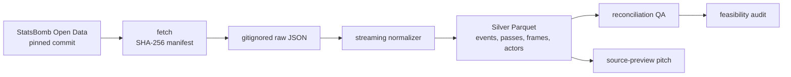

# Phase 0–1 architecture

The fetcher follows only the commit in `manifests/source_data.json`. The normalizer writes typed Parquet a match at a time, so all 64 matches do not have to be held in memory. Anonymous 360 actors have their own table and never acquire player IDs.

